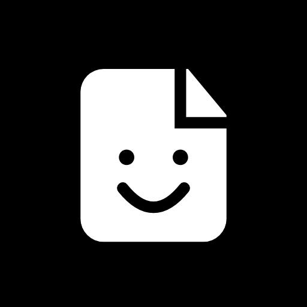

<div align="center">



# Folio

**One toolbox. A lot of possibilities.**

A growing collection of useful tools for files, media, and everyday digital tasks — right in your browser.

**[Open Folio](https://sny4m.github.io/Folio/)** · **[Source code](https://github.com/Sny4m/Folio)**

Made by Sanyam.

</div>

---

## What is Folio?

Folio is my take on a toolbox for the little tasks that somehow always need a different website.

It started with PDF tools, but the idea is much bigger: one place for working with documents, images, video, JSON, developer utilities, and whatever else is genuinely useful. I want it to feel simple and a little playful rather than like a wall of buttons.

I'm building Folio on top of [PaperKnife](https://github.com/potatameister/PaperKnife). It's not just a visual reskin: I've redesigned the experience **and added tools and functionality of my own**. I'm continuing to expand it beyond its PDF roots.

## Tools

**Available today — PDF and document tools**

- Merge PDFs, split files, extract pages, rotate and reorder pages
- Compress, add watermarks and page numbers, edit metadata, and convert pages to images
- Protect, unlock, and attempt to repair PDFs
- Extract text, including English OCR for scanned documents
- Extract embedded images and convert JPG, PNG, and WebP images to PDF
- Add visual signatures, digitally sign documents, and inspect digital signatures

Some operations have limitations: PDF repair is best-effort, and raster-based compression can affect quality.

**Where Folio is going**

The toolkit is growing into several areas:

- **Images:** image editing, conversion, and everyday image utilities
- **Video:** practical video and media tools
- **JSON and data:** formatting, validation, conversion, and related utilities
- **Developer tools:** small helpers for tasks developers do all the time
- **More:** useful tools that fit the same straightforward, browser-first approach

These are directions for expansion, **not a claim that every tool listed is already available**. The app itself is the best place to see what's implemented.

## Built with privacy in mind

The existing PDF and image-to-PDF workflows run locally in your browser using **pdf-lib**, **PDF.js**, **qpdf WebAssembly**, and **Tesseract.js**. Those workflows don't need you to upload documents to a server, and Folio doesn't include analytics or a file-upload endpoint.

Some results, workspaces, digital identities, and saved signatures may remain in browser storage. You can clear saved Folio data in Settings without deleting files you've downloaded.

Folio can also be installed as a progressive web app. Offline caching helps with repeat use, though assets may need to be downloaded on the first visit. As new tools are added, their privacy and offline behavior may differ depending on what they need.

## Run Folio locally

You'll need **Node.js 22 or newer**.

```bash
git clone https://github.com/Sny4m/Folio.git
cd Folio
npm ci
npm run dev
```

The development scripts prepare local qpdf and OCR assets. The first run may download English OCR language data; later runs reuse it.

```bash
npm run lint
npm run build
npm run preview
```

For browser checks, start the preview server on port 4173, install Chromium with `npx playwright install chromium`, and run `npm run test:browser` or `npm run test:workflows`.

## Under the hood

Folio currently uses **React, TypeScript, and Vite**. Its PDF engine combines browser-based libraries, workers, and WebAssembly. The interface uses a monochrome visual style, rounded typography, and hash-based navigation that works on static hosts like GitHub Pages.

It's a work in progress. I'll keep adding tools, refining existing ones, and making the experience easier to use.

## Credits and license

Folio is based on **[PaperKnife](https://github.com/potatameister/PaperKnife)** by **potatameister** (© 2026). I appreciate the work that made the starting point possible.

**Folio's redesign, additional tools, and ongoing development are by Sanyam.** The project retains upstream copyright notices and is licensed under **[AGPL-3.0-or-later](LICENSE)**. If you distribute or host a modified version, you must make its complete corresponding source available as required by that license.

Bundled Fredoka font notices are in `public/fonts/Fredoka-LICENSE.txt`; PDF.js CMap notices are in `public/cmaps/LICENSE`.

---

<div align="center">

**Made by Sanyam.**

</div>
